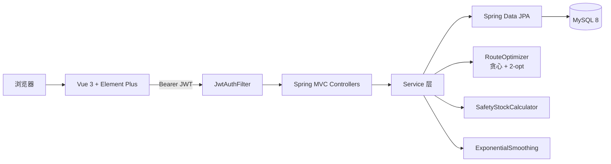

# 昆仑智联 · 智慧油品配送管理平台

面向成品油销售企业的区域配送与运营管理平台，包含 **JWT 鉴权与角色权限、MRP 补货、配送调度、设备维保、经营看板** 五个模块。

<p>
  
  
  
  
  
  
</p>

---

## 功能模块

| 模块 | 说明 |
|---|---|
| **认证与权限** | 用户名密码登录，BCrypt 校验，签发 24 小时 JWT；4 类角色路由级权限控制 |
| **经营看板** | 库存健康度、需求汇总、销量趋势、设备故障排行、待处理订单统计 |
| **MRP 补货** | 读取销售历史，计算安全库存与计划订单，生成补货建议 |
| **配送调度** | 按区域聚合待配送订单，贪心最近邻 + 2-opt 生成配送顺序，分配车辆并跟踪执行 |
| **设备维保** | 设备台账、维保工单创建/派工/开始/完成全流程 |
| **BI 看板** | 面向管理者的汇总视图 |

### 角色

| 角色 | 可访问模块 |
|---|---|
| `MANAGER` | 全部模块 |
| `DISPATCHER` | 看板、MRP、调度、BI |
| `STATION_MASTER` | 看板、设备维保 |
| `MAINTAINER` | 看板、设备维保 |

---

## 技术栈

| 层级 | 技术 |
|---|---|
| 后端 | Java 17、Spring Boot 3.2.5、Spring Data JPA、Spring Security、jjwt 0.12.3 |
| 数据库 | MySQL 8（JPA `ddl-auto=validate`，表结构见 `sql/schema.sql`） |
| 前端 | Vue 3.5、Vue Router 4、Element Plus、Axios、Vite |
| 测试 | JUnit 5 + Spring Boot Test，8 个测试类 |

## 系统架构



### 两个核心算法

- **配送路线**：按区域分组后，用 Haversine 距离计算站点间距离，贪心最近邻构造初始路线，再用 2-opt 做局部优化。
- **安全库存**：`safetyStock = Z × σ × √leadTime`，σ 为样本标准差；服务水平 0.90 / 0.95 / 0.99 分别对应 Z = 1.28 / 1.65 / 2.33。

---

## 目录结构

```text
kunlun-platform/
├── src/main/java/com/kunlun/platform/
│   ├── config/          # Security、JWT 过滤器、CORS
│   ├── controller/      # Auth、Dispatch、DispatchExecution、Equipment、Mrp、Statistics
│   ├── entity/          # 10 个 JPA 实体
│   ├── repository/      # Spring Data JPA
│   ├── service/         # 调度、执行、设备、MRP
│   └── util/            # JwtUtil、RouteOptimizer、SafetyStockCalculator、ExponentialSmoothing
├── src/test/java/       # 8 个测试类
├── kunlun-frontend/     # Vue 3 前端
├── sql/
│   ├── schema.sql       # 表结构
│   └── seed.sql         # 演示数据（账号、站点、油品、车辆、设备、60 天销量）
└── pom.xml
```

---

## 快速开始

### 1. 初始化数据库

```bash
mysql -uroot -p -e "CREATE DATABASE kunlun_platform DEFAULT CHARACTER SET utf8mb4;"
mysql -uroot -p kunlun_platform < sql/schema.sql
mysql -uroot -p kunlun_platform < sql/seed.sql
```

### 2. 启动后端

```bash
export DB_USER=root
export DB_PASSWORD=your_password        # PowerShell: $env:DB_PASSWORD="..."
export JWT_SECRET=your-32-byte-secret   # 生产环境务必替换

./mvnw spring-boot:run
```

后端默认地址：`http://localhost:8080`

### 3. 启动前端

```bash
cd kunlun-frontend
npm install
npm run dev
```

前端默认地址：`http://localhost:5173`，开发服务器已把 `/api` 代理到 `localhost:8080`。

### 演示账号

| 用户名 | 密码 | 角色 |
|---|---|---|
| admin | 123456 | MANAGER |
| dispatcher | 123456 | DISPATCHER |
| manager | 123456 | MANAGER |
| station01 | 123456 | STATION_MASTER |
| maintainer | 123456 | MAINTAINER |

> 演示数据中的密码为明文，登录后会自动升级为 BCrypt 存储；生产环境请直接写入 BCrypt 密码并修改 `JWT_SECRET`。

---

## 主要接口

| 方法 | 路径 | 说明 |
|---|---|---|
| POST | `/api/auth/login` | 登录并返回 JWT |
| GET | `/api/statistics/dashboard` | 经营看板汇总 |
| GET | `/api/statistics/sales-trend` | 销量趋势 |
| GET | `/api/statistics/inventory-health` | 库存健康度 |
| POST | `/api/mrp/run` | 运行 MRP 计算 |
| GET | `/api/mrp/planned-orders` | 计划订单列表 |
| POST | `/api/dispatch/generate` | 按区域生成配送任务 |
| GET | `/api/dispatch/tasks` | 配送任务列表 |
| PUT | `/api/dispatch/tasks/{id}/start` | 开始配送 |
| PUT | `/api/dispatch/tasks/{id}/complete` | 完成配送 |
| GET | `/api/equipment/list` | 设备台账 |
| POST | `/api/equipment/maintenance` | 创建维保工单 |

除 `/api/auth/**` 外，其余接口都需要 `Authorization: Bearer <token>`。

---

## 测试

```bash
./mvnw test
```

测试覆盖 JWT 生成/解析、Haversine 距离与路线优化、安全库存、一次指数平滑，以及调度、执行、设备三个服务的核心流程。

## 说明

- 仓库内的站点、车辆、销量、设备均为演示数据，不包含真实企业数据。
- 演示数据中的“兰州西固油库”为调度服务内置的起点坐标。

## License

[Apache License 2.0](LICENSE)
